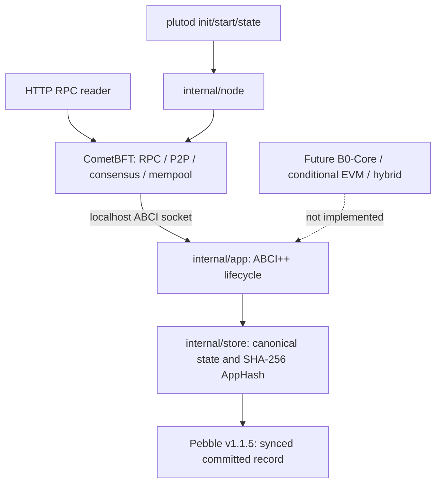
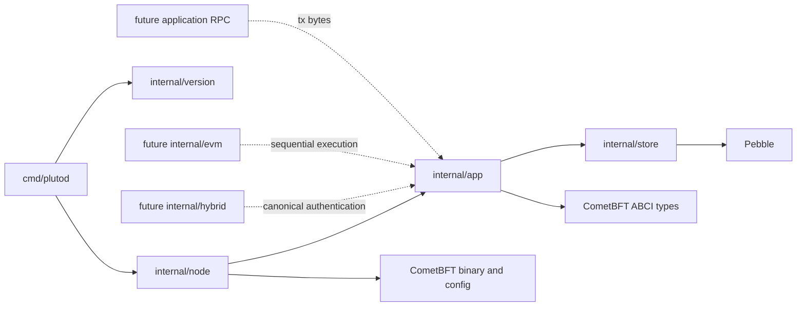
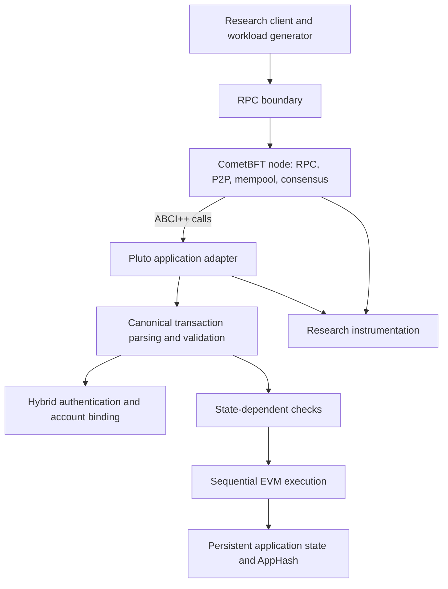
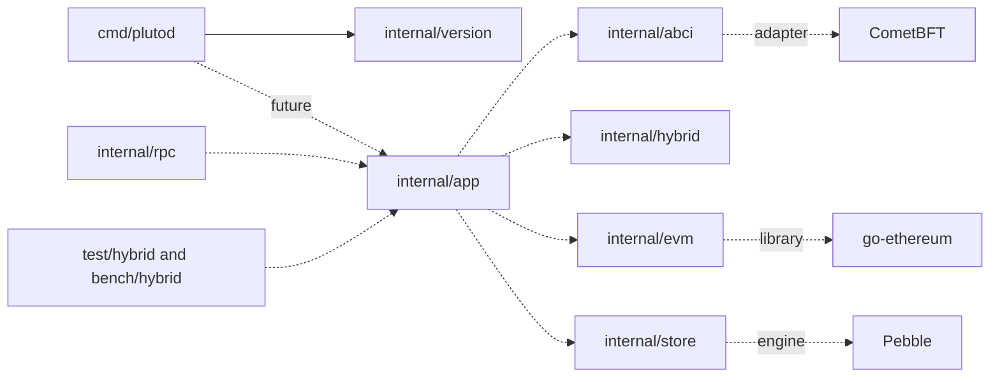

# Pluto architecture — implemented Phase 02 baseline and Phase 02R review

This section supersedes the historical Phase 01 proposal retained below for
traceability. The implemented chain is a **single-validator, transaction-free**
custom Go ABCI++ application connected by a localhost socket to a pinned
CometBFT v0.38.26 child process. It is not an EVM or hybrid chain.
Phase 02R retains this implementation. D-019 requires a complete minimal
classical B0-Core before deciding at Phase 04 whether EVM integration is
needed; no future module in the diagram is currently approved for coding.



CometBFT owns consensus, validator signing, P2P, block construction and the
mempool. Pluto owns application state, ABCI decisions, persistence and AppHash.
`plutod init` invokes the bundled exact-version CometBFT binary to create
genesis, validator and node keys, then sets chain ID, initial height 1, empty
application genesis, localhost ABCI/RPC/P2P listeners and one-second
empty-block interval. `plutod start` checks genesis against Pluto metadata,
opens the exclusive Pebble database, starts the ABCI server and launches the
CometBFT child. SIGINT/SIGTERM stops the child and closes server/database.
`plutod state` reads the database only after node stop. Generated private
validator and node keys must remain private, outside research evidence.

## Implemented ABCI++ lifecycle

```mermaid
sequenceDiagram
  participant C as CometBFT v0.38.26
  participant A as Pluto application
  participant P as Pebble
  C->>A: Info
  A-->>C: last durable height and AppHash
  C->>A: InitChain (new chain only)
  A->>P: sync-write genesis record at height 0
  A-->>C: genesis AppHash; no validator overrides
  C->>A: PrepareProposal (proposer)
  A-->>C: empty tx list
  C->>A: ProcessProposal (all validators)
  A-->>C: ACCEPT only empty tx list and next height
  C->>A: FinalizeBlock (decided block)
  A-->>C: pending next-height AppHash (not durable)
  C->>A: Commit
  A->>P: sync-write entire pending record atomically
  A-->>C: ResponseCommit acknowledgment
```

`CheckTx` returns code 1 for every transaction: user transactions do not
exist in Phase 02. It does not change state. Proposal validation independently
rejects nonempty transaction lists; transactions in proposals need not have
passed every validator's `CheckTx`. A correct proposer drops all input txs.
`FinalizeBlock` errors on nonempty txs, incorrect heights or duplicate
pending finalization; it never reports successful unsupported execution.
Snapshot listing is empty, offers are rejected, queries unsupported, and vote
extensions are not enabled. State sync is not advertised.

The application keeps **committed** and **pending** states separately.
`FinalizeBlock` computes pending state only in memory. `Commit` replaces one
Pebble key with `pebble.Sync`, which requests WAL synchronization before
success, then promotes pending to committed. A failed Save returns an ABCI
error and leaves committed state unchanged. Pebble's lock prevents two writable
opens. On startup `Info` reports the validated persisted record; CometBFT
performs its app/block-store handshake and may replay blocks after a crash.
The integration test covers graceful restart, not arbitrary power-loss
durability or every replay edge case.

## Phase 02 state and AppHash contract

Consensus state is `(format_version uint32=1, chain_id ASCII string,
height int64>=0)`. Chain IDs are 1–50 bytes of ASCII letters, digits, `_`,
`-` or `.`. Genesis is height 0. Every committed empty block increments height
and changes AppHash. The digest is SHA-256 of this canonical byte sequence:

```text
ASCII("PLUTO/APP_STATE/V1") || 0x00 || uint32_be(1) ||
uint16_be(chain_id_byte_length) || chain_id_bytes || uint64_be(height)
```

The persistence record is `ASCII("PLUTO02!") || version || chain_id_length ||
chain_id || height || 32-byte AppHash`, using the same field encodings. Reload
validates exact length, version, chain ID, nonnegative height and recomputed
digest. This is neither a Merkle tree nor an Ethereum trie state root, and it
covers only Phase 02 state. Additional state requires a versioned commitment
and migration decision.

In CometBFT v0.38.26, `ResponseFinalizeBlock` returns the newly finalized
AppHash; `ResponseCommit` has no AppHash. Block header H's `app_hash` reflects
the state after H-1, not after H. `/abci_info` reports the application's
latest committed height and AppHash. These same-numbered RPC fields must not
be compared as though they referred to the same state height.

## Implemented and future module boundaries



Future Pluto transaction handling must separate canonical bytes, secp256k1
and ML-DSA-44 authentication of the same intent, account/key binding,
state-dependent validity, persistent state and AppHash. If Phase 04 approves
EVM, its first execution model is sequential. `HYBRID_REQUIRED` must fail
closed. Consensus-critical results may not depend on local clocks, CPU
budgets, queue occupancy, caches, scheduling or mempool arrival order. No
future modules are implemented now.

The node is localhost-only by default but has signing keys and is not hardened
for hostile networks. Genesis and Pluto metadata are checked on startup;
deleting or modifying one side's database must not trigger an implicit reset.
No arbitrary crash campaign, state sync, migration or multi-validator test has
been done. `example.com/pluto` remains a provisional local module path.
Phase 02R observed that `Run` does not compare the current CometBFT
`config.toml` listener/proxy addresses with the Pluto metadata generated at
`init`; operators must protect and review that file before each run. The
existing checks do not prove cross-store crash recovery or power-loss safety.

## Historical Phase 01 proposal (superseded by implementation and D-019 where applicable)

# Pluto target architecture (Phase 01)

Historical Phase 01 status: **proposed application design**. At that time, the only implemented component was the
`plutod` metadata CLI. Framework behavior below is taken from the CometBFT
v1.0.0 [ABCI++ methods][methods] and [application requirements][requirements].
Those documents define the target contract; no Pluto ABCI compatibility test has
yet been run.

## Components and ownership



CometBFT owns validator consensus, block coordination, P2P dissemination,
its configured mempool and its RPC. Pluto owns transaction representation,
authentication policy, account/key registry, state rules, EVM semantics,
application persistence, deterministic results and AppHash. Hybrid signature
checks belong in Pluto, never inside CometBFT's consensus algorithm.
Research code owns workload generation, instrumentation, correctness oracles,
benchmarks and analysis. It may observe CometBFT, but must not make
consensus-critical application decisions depend on measurements.

The client will submit application transaction bytes through a chosen RPC
route. Standard Ethereum raw transactions do not inherently carry Pluto's
ML-DSA proof. A future Pluto RPC boundary may therefore be needed; its exact
API and transaction format are not specified in Phase 01. CometBFT's P2P and
mempool carry transaction bytes, while Pluto interprets them. An RPC response
is not proof of eventual inclusion or execution.

## Intended transaction lifecycle

```mermaid
sequenceDiagram
  participant Client
  participant C as CometBFT
  participant A as Pluto application
  Client->>C: Submit transaction bytes by RPC
  C->>A: CheckTx (new admission)
  A-->>C: Admit or reject against local committed state
  Note over C,A: Mempool may later request CheckTx recheck after Commit
  C->>A: PrepareProposal (proposer; preliminary tx list)
  A-->>C: Proposed tx list within size rules
  C->>A: ProcessProposal (each validator, including proposer)
  A-->>C: Deterministic accept or reject
  C->>A: FinalizeBlock (decided block)
  A-->>C: Deterministic tx results and AppHash
  C->>A: Commit
  A-->>C: Persisted state acknowledged
```

This is a conceptual flow, not a claim that every node handles each transaction
in this order. Per [v1.0.0 methods][methods], `CheckTx` is an admission filter
and does not apply state changes. Recheck can revisit outstanding mempool
transactions after a commit. `PrepareProposal` is proposer-local and may
modify the preliminary list, subject to size and application coherence rules.
It need not be deterministic, but a correct proposer must prepare a block
other correct applications accept. `ProcessProposal` is consensus-critical:
its accept/reject decision must be deterministic for the relevant state and
proposal. `FinalizeBlock` processes the decided block and supplies execution
results plus AppHash; `Commit` persists the resulting state. The precise state
transition and crash-recovery order will be specified and tested in Phase 02
against [v1.0.0 requirements][requirements].

Never assume a proposed transaction passed `CheckTx` on every validating node.
The proposer can add transactions in `PrepareProposal`, and malicious proposers
can submit arbitrary proposal contents. Also, state may differ from the
admission snapshot when a later proposal is checked. Pluto must independently
apply consensus-critical validity rules to the complete proposal, including
ordering and duplicate handling. Its `FinalizeBlock` behavior must remain
coherent with `ProcessProposal`; a policy for invalid transactions in decided
blocks needs a formal specification before implementation. The v1.0.0
requirements explicitly require coherence between correct `PrepareProposal`
and `ProcessProposal` implementations.

## Data, state and deterministic behavior

The proposed data path separates six concerns:

1. **Canonical transaction bytes:** one bounded, versioned representation and
   unambiguous signed intent; malformed encodings are rejected.
2. **Cryptographic authentication:** both signatures attest the same intent,
   with domain separation and registered keys.
3. **State-dependent validity:** account policy, key version, nonce, balance,
   fees and block constraints against the correct state snapshot.
4. **Sequential EVM semantics:** one ordered execution baseline, including gas,
   receipts, errors and logs, before experimental performance changes.
5. **Persistent application state:** durable account/EVM data and the metadata
   needed for safe recovery.
6. **Committed AppHash:** a deterministic commitment to the application's
   defined state at a height, returned through ABCI++ and reproduced on replay.

The AppHash definition is **unresolved**. It must commit to all
consensus-relevant application state and be recoverable after crashes. A
Pebble database is a storage engine, not itself a Merkle commitment. Ethereum's
trie state root, if used inside the EVM state model, is not automatically the
CometBFT AppHash. Phase 02 must define a commitment scheme and persistence
protocol before calling the application safe. Never hash process-local
iteration order or nondurable state.

For identical committed state and proposal input, consensus-critical decisions
must not depend on local wall-clock time, queue occupancy, CPU budgets,
nonreplicated caches, nondeterministic scheduling or local mempool arrival
order. Local resource signals may inform future admission policy in `CheckTx`
where the ABCI contract permits it; they cannot change `ProcessProposal`,
`FinalizeBlock` or AppHash validity. Proposal fields supplied by CometBFT may
be inputs only according to the pinned ABCI specification.

## Future hybrid boundary

The future `internal/hybrid` module will parse and canonically encode the
application envelope, construct a domain-separated intent, bind account ID
and key version to keys in committed state, and verify secp256k1 and ML-DSA-44
with established libraries. Account policy is applied in state validation.
`HYBRID_REQUIRED` must fail closed if either proof is absent or invalid; no
ECDSA-only fallback is allowed in that profile. Exact bytes, key lifecycle,
FIPS 204 signing mode/context and rejection codes belong in a later protocol
specification and correctness oracle, before implementation. None exists now.

## Intended module dependencies



Solid arrows represent Phase 01 imports. Dashed arrows are proposed boundaries,
not implemented dependencies. `internal/app` will coordinate lifecycle and
policy; `internal/abci` will translate pinned CometBFT types; `internal/evm`
will wrap selected geth execution APIs; `internal/store` will own durable state;
`internal/rpc` will expose application-specific submission; `internal/hybrid`
will own encoding and verification. `test/hybrid` and `bench/hybrid` will hold
oracles and measurements. `deploy/research`, `results` and `paper` are future
experiment deployment, output and publication areas. These directories are not
created in Phase 01.

## Integration uncertainties before implementation

- Verify exact CometBFT v1.0.0 ABCI Go types and lifecycle with a minimal real
  application in Phase 02; no API compile test exists yet.
- Define rejected proposal and invalid decided-block policies without harming
  liveness or validator state consistency.
- Specify a durable AppHash that covers the chosen EVM and account state.
- Reconcile geth's Pebble v1 dependency with any direct storage use; avoid a
  separate v2 path without an explicit migration decision.
- Define stable, portable transaction bytes, key-binding rules, crypto library
  mode and test vectors before hybrid implementation.

[methods]: https://github.com/cometbft/cometbft/blob/v1.0.0/spec/abci/abci%2B%2B_methods.md
[requirements]: https://github.com/cometbft/cometbft/blob/v1.0.0/spec/abci/abci%2B%2B_app_requirements.md
