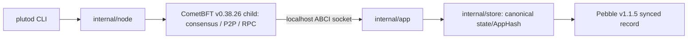

# Pluto Phase 02 completion report — CometBFT Foundation

## 1. Executive Summary

**Status: PASS for the stated Phase 02 local single-validator gates, pending
independent review.** Pluto now starts a real CometBFT v0.38.26 validator,
connects to a custom Go ABCI++ application, commits empty blocks, computes a
deterministic versioned AppHash, sync-writes committed state to Pebble v1.1.5,
and resumes from that state after graceful restart. An automated runtime test
observed real RPC blocks at heights 2 and 4, one validator, durable state
reload, handshake at recovered height 2 and further block production. Unit
tests cover ABCI lifecycle, replay, malformed state and pending/commit
boundaries. The chain executes no user transactions and contains no EVM or
hybrid authentication. Crash behavior under arbitrary power loss and
multi-validator consistency remain untested. This report is **not** approval
for Phase 03.

## 2. Git and Environment

| Item | Observed value |
|---|---|
| Starting commit / resulting commit | Not applicable: user explicitly chose local-only development; no commit, branch, identity, remote or push was created. |
| Local baseline | [BASELINE_SHA256.txt](../evidence/phase_02/BASELINE_SHA256.txt), 16 Phase 01 nonsecret files, verified with `sha256sum -c` before edits. Original Phase 01 report and evidence hashes remain unchanged. |
| Final local source snapshot | [RESULT_SHA256.txt](../evidence/phase_02/RESULT_SHA256.txt), 23 source/config/developer-document files; `sha256sum -c` returned `OK` for all 23 after completion. Reports/evidence are excluded to avoid circular hashes. |
| Branch | Not applicable; local uncommitted workspace. |
| Go / OS | go1.24.1 linux/amd64, WSL2 Ubuntu kernel 6.18.33.2-microsoft-standard-WSL2. |
| CometBFT / Pebble | v0.38.26 / v1.1.5, exact Go module pins and `go.sum` checksums. |
| Environment restriction | Docker unavailable; not needed. First build needs module downloads. Node binds to localhost by default. |

The old Git-commit Gate G1 was **superseded, not completed**, by the user's
explicit contract update. Phase 01's report and original command evidence
remain intact. No Git identity was requested or configured.

## 3. Architecture Implementation



`plutod init` invokes the adjacent pinned `cometbft` binary to create a valid
genesis and local validator/node keys, then sets chain ID, initial height 1,
empty application genesis, localhost RPC/P2P/ABCI and one-second empty-block
interval. It refuses an existing home. `plutod start` validates Pluto metadata
against Comet genesis, starts the ABCI socket server and Comet child, and
handles SIGINT/SIGTERM by stopping the child before closing the server and
database. A missing Pluto database beside existing CometBFT state is rejected,
not silently reinitialized. CometBFT owns consensus and block storage; Pluto
owns application state and AppHash.

State format 1 is `(chain_id, height)` plus version and digest. Genesis is
height 0; each empty block advances height and changes the digest. Canonical
AppHash = `SHA-256("PLUTO/APP_STATE/V1" || 0x00 || uint32_be(version=1) ||
uint16_be(chain_id_length) || chain_id_bytes || uint64_be(height))`. The
persisted record has fixed magic `PLUTO02!`, ordered fields and the digest;
load checks length, version, chain ID, height and recomputed hash. It is not an
Ethereum state root or Merkle commitment. `FinalizeBlock` creates only pending
in-memory state. `Commit` uses one Pebble `Set` with `pebble.Sync` to write the
complete record before promoting it as committed. Genesis is sync-written in
`InitChain`. Pebble's directory lock enforces one writable instance.

CometBFT v0.38.26 takes the new AppHash from `ResponseFinalizeBlock`; its
`ResponseCommit` does not carry one. Header H's `app_hash` corresponds to
application state after H-1, so same-height header and `/abci_info` hashes
are not supposed to match. Full behavior and limitations are in
[ARCHITECTURE.md](../ARCHITECTURE.md).

## 4. ABCI++ Lifecycle

| Method | Implementation | Actual Phase 02 behavior | Test evidence |
|---|---|---|---|
| Info | `internal/app/app.go:Info` | Version/app version plus last durably committed height and AppHash; uninitialized height 0 with no hash. | `TestLifecycleAndDeterministicReplay`, live `/abci_info`, restart handshake. |
| InitChain | `app.go:InitChain` | Validates chain ID, initial height 1 and empty app state; sync-writes genesis; matching height-0 retry is idempotent; conflicting state errors; no validator override. | `TestLifecycleAndDeterministicReplay`, live startup. |
| CheckTx | `app.go:CheckTx` | Stable rejection code 1 for every unsupported tx; no state mutation. | `TestLifecycleAndDeterministicReplay`. |
| PrepareProposal | `app.go:PrepareProposal` | At next height returns no txs, dropping any candidate txs; no committed mutation. | `TestLifecycleAndDeterministicReplay`, real empty blocks. |
| ProcessProposal | `app.go:ProcessProposal` | ACCEPT only expected next height with zero txs, otherwise REJECT; deterministic. | `TestLifecycleAndDeterministicReplay`. |
| FinalizeBlock | `app.go:FinalizeBlock` | Rejects unsupported txs/height errors/duplicate pending; computes pending next state and AppHash without disk write. | `TestLifecycleAndDeterministicReplay`, `TestFinalizeWithoutCommitAndFailure`, Comet logs. |
| Commit | `app.go:Commit` | `pebble.Sync` persistence then promotes pending; no pending or failed Save returns error. | `TestFinalizeWithoutCommitAndFailure`, durable reload and restart. |

`Query` returns unsupported code; `ListSnapshots` returns none,
`OfferSnapshot` rejects, `LoadSnapshotChunk` errors and
`ApplySnapshotChunk` aborts. Vote extensions are not enabled;
`VerifyVoteExtension` rejects. No state-sync capability is advertised.

## 5. Blockchain Runtime Evidence

The automated test initialized chain `pluto-integration`, validator count
**1**, and observed consensus at height **2** with `/block?height=2`
containing **0** transactions and header AppHash
`2FEEDFE06A0D35171D8FEC8B7EF7CBDB8899E37A2B7FEB6A1FCDB213E3A4C8A4`.
`/abci_info` reported application height 2, AppHash base64
`7rQjwkAiR497QXqTRGSoM/yUq/Lh/YWYEE9qNIdvgjI=`. The height-2 durable
application AppHash in hex is
`eeb423c24022478f7b417a934464a833fc94abf2e1fd8598104f6a34876f8232`.
After restart, RPC reached height **4** with header AppHash
`D45F6AD501507ABF86CB14CE4154DB5CB4E7336E733979FEBCD51DAADEF7BBCE`;
durable application height 4 had AppHash
`a8c1f506f3d3e8bc310d38b596040c2b1b954295e80684fff73b9536a3ca6f2a`.
The test logged the actual initial handshake at app height 0, initial node
startup, a finalized height-1 block, restarted handshake at app height 2,
restart startup, and finalized height-3 block. Exact RPC values and raw
selected CometBFT log lines are retained in
[EXECUTION_LOG.md](../evidence/phase_02/EXECUTION_LOG.md). These values are
from real CometBFT RPC and logs, not manual application counter increments.

An additional manual run on chain `pluto-phase02-test` committed to height 54,
stopped, recovered height 54 with identical hash in the Comet handshake, then
advanced to height 130; it is corroborating observation, not a benchmark.

## 6. Persistence and Recovery

| Field | Before restart (independent state reload) | Immediately recovered after restart | After further blocks | Result |
|---|---|---|---|---|
| Chain ID | `pluto-integration` | `pluto-integration` | `pluto-integration` | PASS |
| State version | 1 | 1 | 1 | PASS |
| Height | 2 | handshake `appHeight=2` | 4 | PASS |
| AppHash | `eeb423c2…76f8232` | same full hash in handshake | `a8c1f506…ca6f2a` | PASS |
| Continued production | not applicable | started | height 4 observed by RPC | PASS |

The full hashes are in section 5 and the evidence file. State reload is via
`plutod state` after graceful stop, which independently opens Pebble. Direct
unit tests separately show that `FinalizeBlock` without `Commit` is absent
after reopen, malformed persisted records are rejected, a second writable
open fails, and a rejected Save does not promote pending state. The Save
failure test corrupts the pending record to trigger validation before the
write; it does **not** simulate a disk full/faulty filesystem. No arbitrary
power-loss recovery claim is made.

## 7. Testing and Verification

All final mandatory commands exited **0** on 2026-10-15. Exact relevant
outputs are retained in [EXECUTION_LOG.md](../evidence/phase_02/EXECUTION_LOG.md).

| Command | Exit | Result |
|---|---:|---|
| `go build ./...` | 0 | All Pluto packages compile. |
| `go test ./...` | 0 | CLI, ABCI and store packages pass; node/version have no direct unit tests. |
| `go test -count=1 -v ./...` | 0 | 6 top-level tests plus 5 CLI subtests pass; no failures/skips. |
| `go vet ./...` | 0 | No diagnostics. |
| `make fmt-check` | 0 | `gofmt` reports no files. |
| `go mod verify` | 0 | All modules verified. |
| `make verify` | 0 | Builds pinned binaries, unit tests, vet, format, checksum and CLI version. |
| `make test-integration` | 0 | Real node init, RPC, block, one-validator, stop, restart, state reload, further blocks and missing-state refusal. |
| `go test -tags integration ./test/integration -timeout 120s -count=1 -v` | 0 | One integration test passes, exposing actual RPC and Comet logs. |
| `go test -race ./internal/app ./internal/store` | 0 | Relevant state/persistence tests pass under race detector. |
| `go test -cover ./internal/app ./internal/store` | 0 | Statement coverage 77.5% / 88.2%; not a safety proof. |
| `./build/plutod version`; `./build/cometbft version` | 0 | `0.2.0-foundation` / `0.38.26`. |
| `sha256sum -c research/evidence/phase_02/RESULT_SHA256.txt` | 0 | All 23 final source/config/developer-document files `OK`. |

No tests were skipped in the final suite. The earlier development-time test
failures (a Pebble closed-DB panic from an invalid failure-injection method,
then a lock-held reopen) were fixed by using a corrupt pending record and
closing before reopen; final tests pass. Full database-fault injection remains
deferred. The local Phase 01 baseline check passed before Phase 02 edits; it
is not expected to match modified files afterward.

## 8. Invariant Assessment

| ID | Status | Evidence and limitation |
|---|---|---|
| F1 | PASS | Two independent apps receive identical genesis and ordered ABCI calls, yielding identical AppHash sequences at heights 1–3; no multi-node replay claim. |
| F2 | PASS | `CheckTx` rejects and committed state comparison remains equal. |
| F3 | PASS | Prepare/Process called before each block, committed state comparison unchanged. |
| F4 | PASS | `Info` remains previous height after Finalize; close/reopen without Commit preserves genesis. |
| F5 | PASS | Commit Save with `pebble.Sync` and independent reload; arbitrary power loss untested. |
| F6 | PASS | Info checked before init, after Finalize and after Commit; live handshake uses recovered state. |
| F7 | PASS | Real stop/restart preserves chain, height 2 and exact hash; later height 4. |
| F8 | PASS | CheckTx code 1, proposal REJECT, Finalize error on unsupported tx. |
| F9 | PASS | Duplicate/skipped heights, conflicting chain, corrupt state and rejected Save tested; actual disk I/O failure not injected. |
| F10 | PASS | Bundled CometBFT node RPC `/status`, `/block`, `/validators` and logs show real consensus blocks. |

These are tested properties, not formal proofs.

## 9. Acceptance Gate Assessment

| Gate | Status | Evidence |
|---|---|---|
| G1 | PASS | User-superseded local baseline: 16 SHA-256 checksums captured and verified before edits; 23 final source checksums verified after edits. Phase 01 report/evidence unchanged. No commit required or claimed. |
| G2 | PASS | v0.38.26 reviewed against official release/advisories, pinned in `go.mod`/`go.sum`, compiled and used. |
| G3 | PASS | `internal/app.App` satisfies the selected `abci.Application` interface and runs through actual socket integration. |
| G4 | PASS | Real `plutod start` and Comet startup log/RPC in integration test. |
| G5 | PASS | RPC block heights 2 and 4 plus finalized-block logs. |
| G6 | PASS | Canonical state/AppHash contract and encoding tests. |
| G7 | PASS | Pending/committed tests and `FinalizeBlock` without Commit reopen. |
| G8 | PASS | Synced Pebble record, independent reload and graceful restart; not an arbitrary-power-loss claim. |
| G9 | PASS | Lifecycle unit test plus real ABCI handshake/blocks. |
| G10 | PASS | CheckTx code 1, proposal rejection and Finalize error. |
| G11 | PASS | Two-instance deterministic replay and independent state reload. |
| G12 | PASS | Recovery at height 2 and continued RPC height 4; manual height 54→130 corroborates. |
| G13 | PASS | Build, test, vet, format, module verification, race and integration all exit 0. |
| G14 | PASS | CLI commands, localhost ports, restart and limitations documented in README/architecture/decisions/manifest. |
| G15 | PASS | Baseline checksums, exact command outputs, RPC heights/hashes and actual selected Comet startup/finalize logs in evidence. |
| G16 | PASS | Source inspection: no account, tx execution, EVM, hybrid crypto, admission mechanism or consensus change. |
| G17 | PASS | Phase status/AGENTS/report state Phase 03 is unapproved. |

**17/17 Phase 02 gates pass at the tested scope.** Independent review may
identify rework; this self-assessment is not final approval.

## 10. Known Issues and Risks

- CometBFT security review covered the named applicable advisories and release
  metadata, not a full audit of transitive dependencies or an assurance that
  v0.38.26 is vulnerability-free. The chosen 0.38 API differs from the Phase
  01 v1.0.0 conceptual reference. Reassess advisories before public exposure.
- The application and CometBFT maintain separate durable stores. Graceful
  restart and app reload are tested; arbitrary power-loss ordering, WAL
  corruption, Comet block replay after partial commit and filesystem fault
  injection need dedicated work before stronger crash-safety claims.
- The AppHash commits only `(version, chain ID, height)`; account/EVM state will
  need a new versioned commitment and migration. No state sync or snapshot
  support exists. Database corruption fails startup rather than self-healing.
- The child-process model depends on the adjacent pinned Comet binary and
  localhost ports being available. A partial `init` can leave a directory for
  operator inspection; there is no automatic destructive cleanup.
- App/store statement coverage is 77.5%/88.2%; unsupported ABCI method
  paths and operational I/O failures are not exhaustively exercised.
- The repository module path `example.com/pluto` is provisional for local
  development. There is no Git commit/branch, by explicit user choice;
  reproducibility rests on the baseline manifest, source files, module pins
  and report. Full runtime logs are ephemeral; selected exact lines are
  retained in evidence and the integration test can reproduce them.
- A single validator does not test Byzantine fault tolerance, distributed
  AppHash agreement or hostile-network operation. Performance and security
  under invalid transaction workloads remain entirely unmeasured.

## 11. Scope Compliance

No EVM, account balances/nonces, classical or hybrid transaction execution,
secp256k1/ML-DSA authentication, admission control, priority queue, custom
consensus or benchmark claim was introduced. The indirect module graph may
contain cryptographic libraries used by CometBFT itself; Pluto does not use
them for transaction authentication. Unsupported transactions are explicitly
rejected. Phase 03 was not begun.

## 12. Next-Phase Readiness

Phase 03 can reuse the real CometBFT runtime, ABCI lifecycle, state
serialization/persistence boundary, deterministic replay test pattern and
local RPC harness. Before classical transactions, separately authorize Phase
03 and specify canonical bytes, secp256k1 key binding, account/nonce/balance
state, deterministic proposal and execution validity, error/result semantics,
AppHash format migration and crash/replay behavior with transaction state.
No Phase 03 implementation is authorized by this report.

## 13. Final Verdict

```text
PHASE: 02
STATUS: PASS
BASE_COMMIT: not_applicable_local_only_user_superseded
RESULT_COMMIT: not_applicable_local_uncommitted_workspace
LOCAL_BASELINE: research/evidence/phase_02/BASELINE_SHA256.txt
LOCAL_RESULT_SNAPSHOT: research/evidence/phase_02/RESULT_SHA256.txt
COMETBFT_VERSION: v0.38.26
STORAGE_VERSION: pebble_v1.1.5
REAL_NODE_STARTUP: PASS
BLOCK_PRODUCTION: PASS_heights_2_and_4_real_RPC
ABCI_INTEGRATION: PASS
APPHASH_DETERMINISM: PASS_tested_two_instance_replay
DURABLE_COMMIT: PASS_pebble_sync_and_graceful_reload
RESTART_RECOVERY: PASS_recovered_height_2_then_advanced_to_4
UNIT_TESTS: PASS_6_top_level_5_CLI_subtests
INTEGRATION_TESTS: PASS_1_real_node_restart_test
STATIC_ANALYSIS: PASS_go_vet_and_fmt_check
ACCEPTANCE_GATES_PASSED: 17/17_at_tested_scope
KNOWN_BLOCKERS: none_for_local_Phase_02;_power_loss_and_multi_validator_untested
READY_FOR_INDEPENDENT_REVIEW: YES
PHASE_03_AUTHORIZED: NO
```
